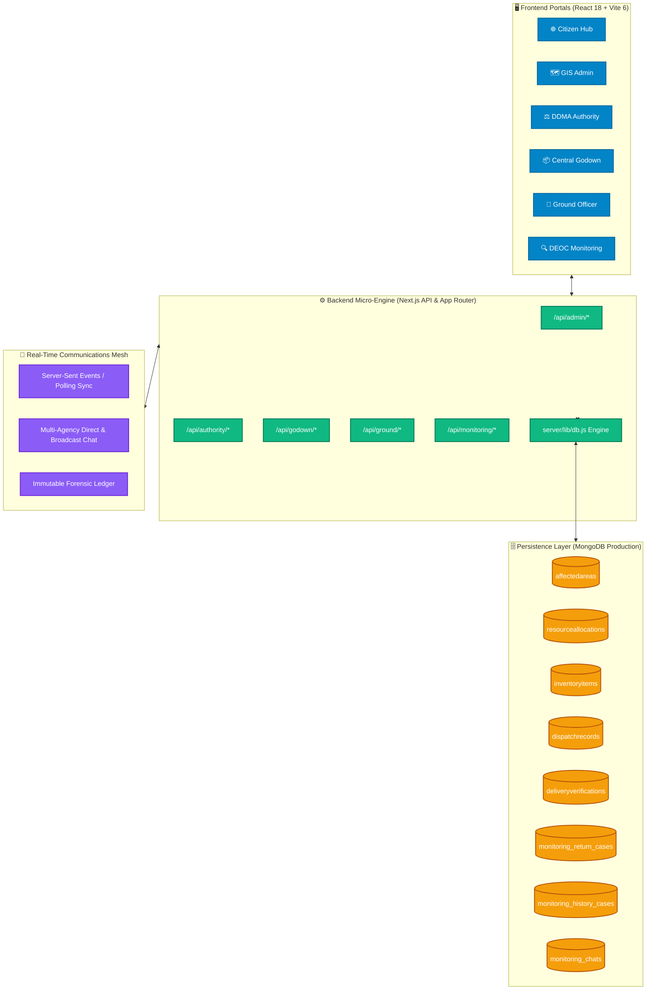
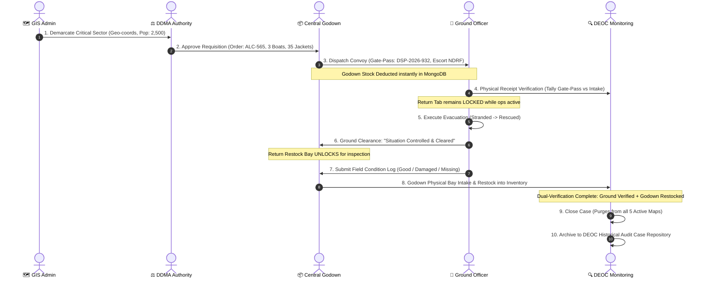

# 🌊 NEERAKSHAK (नीरक्षक)
### *Next-Generation AI & GIS Powered Multi-Agency Flood Disaster Management, Logistics Chain-of-Custody, and Forensic Audit System*

<div align="center">


<p align="center">
  <b>A unified, real-time command, telemetry, and forensic audit ecosystem designed for District Disaster Management Authorities (DDMA), Central Relief Warehouses, NDRF/SDRF Field Units, and District Emergency Operation Centers (DEOC).</b>
</p>

[System Overview](#-executive-summary) • [Core Portals](#-portal-architecture--capabilities) • [System Architecture](#-system-architecture--data-flow) • [Lifecycle & Workflows](#-operational-lifecycles--audit-guards) • [Version Changelog](#-version-control-history--major-releases) • [API Engine](#-api-endpoints--backend-architecture) • [Engineering Team](#-core-engineering--developer-credits)

---

</div>

## 📌 Executive Summary

During critical flood events, response operations suffer from **coordination failure**, **ghost consignments**, **inventory hoarding**, **loss of escort telemetry**, and **unverified returns**. 

**NEERAKSHAK** eliminates operational ambiguity by enforcing an unbroken, end-to-end **Chain of Custody (CoC)** governed by strict **Dual-Verification protocols**, cryptographic gate-passes, live GIS spatial telemetry, and an automated cross-portal reconciliation engine.

> [!IMPORTANT]
> **Strict Zero-Mock Production Standard:** NEERAKSHAK runs exclusively on a live MongoDB single source of truth. Every allocation, waybill, gate-pass, SITREP escalation, convoy transit event, and return intake is backed by persistent database transactions with cross-portal real-time synchronisation.

---

## 🏛️ Portal Architecture & Capabilities

The ecosystem is partitioned into **5 specialized operational portals** + **1 Citizen Public Hub**, each tailored to exact administrative clearance levels:

```
┌───────────────────────────────────────────────────────────────────────────────────────────────────┐
│                                   NEERAKSHAK COMMAND GRID                                        │
├───────────────┬───────────────────┬───────────────────┬───────────────────┬───────────────────────┤
│ 1. PUBLIC     │ 2. ADMIN (GIS)    │ 3. DDMA AUTHORITY │ 4. GODOWN (DEPOT) │ 5. GROUND OFFICER     │
│ Citizen Hub   │ Spatial Mapping   │ Resource Approval │ Logistics Fleet   │ NDRF Tactical Rescue  │
├───────────────┴───────────────────┴───────────────────┴───────────────────┴───────────────────────┤
│                             6. DEOC FORENSIC MONITORING AUDIT CONTROL                             │
└───────────────────────────────────────────────────────────────────────────────────────────────────┘
```

### 1. 🌐 Public Flood Portal & Citizen Watch (`/`)
* **Live River Telemetry:** Dynamic hydrological gauges tracking water level vs danger thresholds with live trend indicators (Rising/Falling/Steady).
* **Emergency Broadcast Stream:** High-priority news bulletins, DEOC emergency helpline dialers (`1077`, `112`), and NDRF evacuation advisories.
* **Citizen SOS & Camp Directory:** Geo-tagged relief shelters, operational capacity gauges, medical posts, and safe evacuation corridors.

### 2. 🗺️ District Administrator & GIS Geospatial Command (`/admin`)
* **Interactive Leaflet GIS Mapping:** Real-time visual demarcations of flood-affected sectors with automated centroid auto-focus.
* **Severity Classification Engine:** Dynamic tagging of zones (*Critical*, *High*, *Moderate*, *Normal*) with casualty counts and marooned population metrics.
* **Emergency Infrastructure Registry:** Interactive map-based placement of emergency facilities (Field Hospitals, Police Stations, NDRF Staging Camps, Helipads).
* **Cross-Agency Broadcast Transmitter:** Publishes instant emergency alerts directly to ground units, warehouses, and the public dashboard.

### 3. ⚖️ District Disaster Management Authority (`/authority`)
* **Resource Requisition Processing:** Reviews urgent requirements submitted by Field SITREPs, village panchayats, and administrative blocks.
* **Quota Approval & Allocation:** Approves itemized rescue and relief quotas (Motorized Inflatable Boats, SOLAS Life Jackets, Dry Rations, Trauma Kits).
* **Multi-Agency Escort Deployment:** Assigns tactical NDRF/SDRF battalions, lead inspection officers, convoy vehicles, and transport authorization orders.
* **Extra-Item Field Merge Protocol:** Seamlessly aggregates supplementary requirements submitted by Ground SITREPs into existing operational dossiers.

### 4. 📦 Central Godown & Logistics Depot (`/godown`)
* **Live Warehouse Inventory Engine:** Real-time stock counters with instant deductions on dispatch and restock increments upon verified return.
* **Cryptographic Gate-Pass Generator:** Generates verifiable transit waybills (`DSP-YYYY-XXX`) containing driver credentials, vehicle registration, and escort rosters.
* **Fleet Convoy Telemetry Tracker:** Visual route monitoring with driver phone contact, live ETA milestones, and transit checkpoint confirmations.
* **Return Restock Bay Intake:** Strictly locked until Ground Officer confirms field ops complete; itemizes returned vs damaged vs missing gear.

### 5. 🛟 Ground Field Officer & Tactical Rescue Command (`/ground-officer`)
* **Assigned Sectors & Gate-Pass Intakes:** Physical delivery verification verifying gate-pass quotas against actual field receipts with instant discrepancy alerts.
* **Field SOS SITREP Submissions:** Reports live inundation depths, stranded citizen tallies, road submersion status, and extra item requisitions.
* **NDRF Tactical Evacuation Coordination:** Real-time rescue progress counters (Stranded vs Evacuated) with direct hotline integration.
* **Guarded Dual-Verification Return:** Multi-stage safety lock requiring the Field Officer to confirm *"Situation Controlled & Cleared"* before equipment restock unlocks.

### 6. 🔍 DEOC Monitoring & Forensic Audit Center (`/monitoring`)
* **5-Stage Full Lifecycle Audit:** Live state machine tracking every sector:
  $$\text{Requisition} \xrightarrow{\quad} \text{Dispatched} \xrightarrow{\quad} \text{Ground Receipt} \xrightarrow{\quad} \text{Reconciliation} \xrightarrow{\quad} \text{Restocked}$$
* **Automated Discrepancy Detection:** Flags variances between Dispatched, Received, Consumed, and Restocked quantities.
* **Inter-Agency Real-Time Communications Mesh:** Full duplex instant messaging with `ALL` broadcast vs `FOR YOU` direct badges across all roles.
* **Case Closure & Cross-Portal Purging:** Archiving completed cases to historical forensic records while instantly purging resolved data from active operations maps.

---

## 🏗️ System Architecture & Data Flow



---

## 🔄 Operational Lifecycles & Audit Guards

### The Multi-Agency Dual-Verification Protocol



---

## 📦 Version Control History & Major Releases

NEERAKSHAK evolved through **7 major architectural milestones**, transforming from an early prototype into a production-hardened disaster management platform:

```
┌──────────────────────────────────────────────────────────────────────────────────────────────────┐
│                                NEERAKSHAK EVOLUTION TIMELINE                                     │
├───────────────┬────────────────┬────────────────┬────────────────┬───────────────┬───────────────┤
│ v1.0.0 (Nov20)│ v1.5.0 (Nov22) │ v2.0.0 (Nov24) │ v2.2.0 (Nov26) │ v2.4.0 (Nov27)│ v2.5.0 (Nov28)│
│ Architecture  │ DEOC Engine    │ Telemetry & CoC│ Dual-Verify    │ Chat & Purge  │ Pure Real-Data│
└───────────────┴────────────────┴────────────────┴────────────────┴───────────────┴───────────────┘
```

### 🔹 Milestone 1: v1.0.0 — Ground Officer GIS & Next.js App Router Architecture
* **Commit:** `0f52638` & `aa0ef4f` *(20 Nov 2026)*
* **Key Deliverables:**
  - Replaced legacy mock orientation widgets with full **Leaflet Interactive GIS Engine**.
  - Engineered **Next.js App Router backend** microservices (`/api/ground/*`, `/api/admin/*`).
  - Added 3-column responsive command grid with instant sector quick-actions.
  - Resolved dynamic map viewport rendering and dynamic container sizing.

---

### 🔹 Milestone 2: v1.5.0 — DEOC Forensic Monitoring Engine & 10 Core Functions
* **Commit:** `271fd71` & `32c261a` *(22 Nov 2026)*
* **Key Deliverables:**
  - Introduced the **DEOC Forensic Audit Center** with 9 dedicated audit tabs.
  - Implemented the **5-Stage Lifecycle State Machine** (`Approved` $\rightarrow$ `Dispatched` $\rightarrow$ `Received` $\rightarrow$ `Audited` $\rightarrow$ `Returned`).
  - Built real-time river hydrology telemetry integration and discrepancy reconciliation engines.
  - Added automated variance calculation between dispatches and physical receipts.

---

### 🔹 Milestone 3: v2.0.0 — Chain-of-Custody, Fleet Telemetry & Escort Roster
* **Commit:** `f23ec7a` & `c704cdf` *(24 Nov 2026)*
* **Key Deliverables:**
  - Standardized the **Multi-Agency Chain of Custody (CoC)** data contracts across all portals.
  - Bound Convoy Driver credentials, vehicle registration, and NDRF Battalion Escort Officers to each gate-pass.
  - Integrated live convoy tracking with telephone dialers and driver route progress.
  - Added field photo/document evidence uploads with auto-generated verification waybills.

---

### 🔹 Milestone 4: v2.2.0 — Dual-Verification Return Protocol & Restock Guards
* **Commit:** `659a78a` & `86a8ffd` *(26 Nov 2026)*
* **Key Deliverables:**
  - Implemented **Return Intake Guard**: Restock bay strictly locked until Ground Officer issues *"Situation Controlled & Cleared"*.
  - Engineered itemized condition breakdown (`Good Condition`, `Damaged`, `Missing In Action`).
  - Fixed inventory zero-reset glitch: verified equipment in good condition increments central godown stock.
  - Eliminated unverified return cards from godown restock queues.

---

### 🔹 Milestone 5: v2.4.0 — Multi-Agency Real-Time Chat & Extra SITREP Requisitions
* **Commit:** `441f1b7` & `54defe2` *(27 Nov 2026)*
* **Key Deliverables:**
  - Integrated **Cross-Portal Real-Time Messenger Hub** with `ALL (Broadcast)` vs `FOR YOU (Direct Directive)` badges.
  - Enabled Ground Officers to request supplementary equipment item-wise directly within field SITREPs.
  - Engineered automatic requisition merging at District Authority level.
  - Built **Cross-Portal Active Data Purging**: closing a verified case purges the sector from all active portals while archiving to DEOC history.

---

### 🔹 Milestone 6: v2.5.0 — 100% Real-Data MongoDB Production Standard (Zero-Mock)
* **Commit:** `9267239`, `1e72843` *(28 Nov 2026)*
* **Key Deliverables:**
  - Permanently excised `seed.js`, `seedData.js`, and `NEERAKSHAK_SEED_DATA` mock fallbacks from client and server.
  - Cleaned all legacy mock collections from MongoDB Atlas.
  - Populated Central Godown with 8 standardized disaster emergency equipment inventory records.
  - Enforced single-source-of-truth database integrity: all portals display 100% live user data.

---

## 🔌 API Endpoints & Backend Architecture

The backend exposes clean REST endpoints powered by `server/lib/db.js`:

| Portal / Module | HTTP Route | Method | Description |
|---|---|---|---|
| **Admin** | `/api/admin/areas` | `GET`, `POST`, `DELETE` | List, demarcate new critical flood sectors, and clear resolved zones |
| **Admin** | `/api/admin/facilities` | `GET`, `POST` | Geo-locate emergency hospitals, police stations, and helipads |
| **Admin** | `/api/admin/alerts` | `GET`, `POST` | Publish district flood broadcast bulletins |
| **Authority** | `/api/authority/allocations`| `GET`, `POST` | Approve resource allocations & assign convoy escort officers |
| **Authority** | `/api/authority/requests` | `GET`, `POST` | Review field SITREP requisitions and merge extra requirements |
| **Godown** | `/api/godown/inventory` | `GET`, `POST`, `PUT` | Live warehouse inventory lookup, stock replenishment, and updates |
| **Godown** | `/api/godown/dispatch` | `POST` | Generate gate-pass, deduct inventory, and dispatch convoy |
| **Godown** | `/api/godown/returns` | `GET`, `POST` | Process physical bay restock after dual-verification clearance |
| **Ground** | `/api/ground/verify` | `POST` | Physical receipt acknowledgement & shortage recording |
| **Ground** | `/api/ground/sitrep` | `POST` | Submit flood SITREP, stranded citizen count & extra requirements |
| **Ground** | `/api/ground/clearance` | `POST` | Confirm *"Situation Under Control"* & unlock return intake |
| **Monitoring** | `/api/monitoring/cases` | `GET`, `POST` | DEOC lifecycle audit, return reconciliation & forensic case closure|
| **Comms** | `/api/monitoring/chat` | `GET`, `POST` | Full-duplex inter-portal real-time messaging engine |

---

## 🚀 Setup & Local Execution Guide

### Prerequisites
* **Node.js:** v18.0.0 or higher (v22 LTS recommended)
* **MongoDB:** Local MongoDB daemon or MongoDB Atlas connection string
* **Git:** Version 2.30+

### Installation Steps

```bash
# 1. Clone the repository
git clone https://github.com/razashoeb840/Neerakshak.git
cd Neerakshak

# 2. Install dependencies
npm install

# 3. Configure Environment Variables
# Create a .env or .env.local file in the project root:
echo "MONGODB_URI=your_mongodb_connection_string" > .env.local
echo "PORT=3000" >> .env.local

# 4. Start Development Server (Vite + Next.js APIs)
npm run dev

# 5. Build for Production Verification
npm run build
```

---

## 👥 Core Engineering & Developer Credits

<div align="center">

The **NEERAKSHAK** Emergency Disaster Management & Forensic Telemetry System was conceptualized, designed, and developed by:

<br/>

| ### 🚀 SHOEB RAZA | ### ⚡ SUSHANT RANJAN | ### 🛡️ ADITYA GUPTA |
| :---: | :---: | :---: |
|  |  |  |
| *Core Architecture, Next.js API Services, MongoDB Engine, Dual-Verification & Audit Lifecycles* | *Interactive Portal Interfaces, Responsive Layouts, Multi-Portal State & Real-Time Chat Engine* | *Leaflet Geospatial Mapping, Telemetry Data Pipelines, Forensic Verification & System Security* |
| [](https://github.com/razashoeb840) | [](https://linkedin.com) | [](https://github.com) |

<br/>

```
╔═══════════════════════════════════════════════════════════════════════════════════════╗
║                                 MISSION STATEMENT                                     ║
║   "Ensuring that no relief consignment goes untracked, no flood victim is left       ║
║    unrescued, and every public disaster rupee is accounted for with cryptographic     ║
║    transparency and speed."                                                           ║
╚═══════════════════════════════════════════════════════════════════════════════════════╝
```

---

<p align="center">
  <b>NEERAKSHAK © 2026. Built with pride for disaster resilience and public safety.</b>
</p>

</div>
